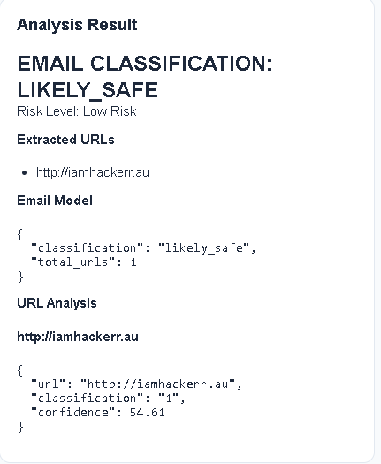
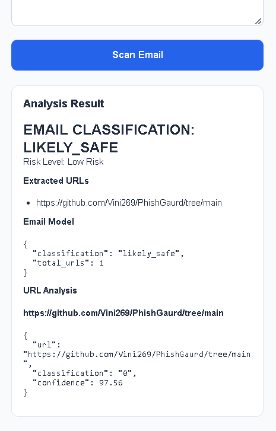

:::writing{variant="document" id="82519"}
# 🛡️ PhishGaurd – AI-Powered Phishing Detection System

### Detect. Analyze. Protect.

**PhishGaurd** is a collaborative cybersecurity project developed to identify and analyze potentially malicious websites and phishing threats using Machine Learning.

The project combines data analysis, machine learning model development, backend services, and browser extension development to create an integrated phishing detection solution.

Our goal is to make browsing safer by helping users identify potential phishing threats through an intelligent and accessible detection system.

---

## 📌 Table of Contents

- Overview
- Problem Statement
- Project Objectives
- Key Features
- System Architecture
- Technology Stack
- Project Structure
- Application Screenshots
- Team Contributions
- Installation and Setup
- Future Scope
- Disclaimer

---

## 🔍 Overview

Phishing attacks are a major cybersecurity concern. Attackers frequently use fraudulent websites and malicious URLs to trick users into revealing sensitive information.

PhishGaurd aims to address this challenge through a machine learning-based phishing detection approach.

The project is divided into multiple components:

- **Data Analysis:** Exploring and understanding phishing-related datasets to identify meaningful patterns and features.
- **Machine Learning:** Developing a model to distinguish between potentially legitimate and phishing-related URLs.
- **Backend Services:** Supporting communication and integration between application components.
- **Browser Extension:** Providing users with an accessible interface to interact with the detection system.

This project represents a collaborative effort involving data analysis, machine learning, and application development.

---

## 🎯 Problem Statement

With the increasing number of phishing attacks, identifying malicious websites has become increasingly difficult for ordinary internet users.

Traditional security approaches may not always identify newly emerging phishing websites.

PhishGaurd explores the use of machine learning techniques to analyze website-related data and assist in identifying potential phishing threats.

---

## ✨ Key Features

- 🛡️ **Phishing Detection:** Identifies potentially suspicious websites using machine learning.
- 🤖 **ML-Based Analysis:** Utilizes a trained machine learning model for phishing classification.
- 🌐 **Browser Extension:** Provides a convenient browser-based user experience.
- 📊 **Data-Driven Approach:** Uses dataset analysis to understand phishing patterns.
- ⚙️ **Modular Architecture:** Separates backend, machine learning services, and browser extension components.
- 🔄 **Integrated Workflow:** Connects different project components to deliver detection results.

---

## 🏗️ System Architecture

PhishGaurd follows a modular architecture where different components work together.

```text
                 USER
                   |
                   v
          BROWSER EXTENSION
                   |
                   v
                BACKEND
                   |
                   v
             ML SERVICES
                   |
                   v
          MACHINE LEARNING MODEL
                   |
                   v
          PHISHING CLASSIFICATION
                   |
                   v
           RESULTS TO THE USER
```

### Main Components

| Component | Responsibility |
|---|---|
| Data Analysis | Dataset exploration and feature analysis |
| ML Model | Model development and phishing classification |
| Backend | Application logic and component communication |
| Browser Extension | User interaction and detection interface |
| ML Services | Machine learning service integration |

---

## 🧰 Technology Stack

The project involves the following technical areas:

- Data Analysis and Exploratory Data Analysis (EDA)
- Machine Learning
- Backend Development
- Browser Extension Development
- Dataset Processing and Feature Analysis

*Specific programming languages, frameworks, and libraries can be added here based on the final implementation.*

---

## 📁 Project Structure

```text
PhishGaurd/
│
├── backend/          # Backend application
│
├── data/             # Dataset and supporting data
│
├── extension/        # Browser extension
│
├── ml-services/      # Machine learning services
│
├── model/            # Machine learning model resources
│
├── notebooks/        # Data analysis and experimentation
│
└── .gitignore
```

---

## 📸 Application Screenshots

The following screenshots showcase the application interface and its functionality.

### 1. Main Application Interface


### 2. Browser Extension


### 3. Phishing Detection Result



### 4. Safe Website Detection



---

## 👥 Team Contributions

PhishGaurd was developed as a collaborative team project, with each member contributing to a different part of the system.

### 1. Vini – Data Analyst

**Primary Responsibility: Data Analysis and Exploratory Data Analysis**

Contributions:

- Performed Exploratory Data Analysis (EDA) on the phishing URL dataset.
- Analyzed dataset distribution and class balance.
- Explored relationships and correlations between different features.
- Identified relevant patterns and characteristics associated with phishing URLs.
- Created visualizations to communicate analytical findings.
- Supported the machine learning development process through data-driven insights.

### 2. Manas – Machine Learning Developer

**Primary Responsibility: Machine Learning Model Development**

Contributions:

- Worked on machine learning model creation.
- Developed the model for phishing URL classification.
- Worked on model training and experimentation.
- Contributed to the implementation of the machine learning detection component.

### 3. Madhav – Browser Extension Developer

**Primary Responsibility: Browser Extension Development**

Contributions:

- Developed the browser extension component.
- Worked on the extension's user interface and functionality.
- Integrated the extension with the phishing detection workflow.
- Worked on making the detection system accessible through a browser-based experience.

### 🤝 Collaborative Development

All three members contributed to building PhishGaurd as an integrated cybersecurity solution.

The project combines data analysis, machine learning, and browser extension development to address a real-world cybersecurity problem.

---

## ⚙️ Installation and Setup

### Prerequisites

- Git
- Python
- Required Python libraries and dependencies
- Compatible web browser

### 1. Clone the Repository

```bash
git clone https://github.com/Vini269/PhishGaurd.git
```

### 2. Navigate to the Project

```bash
cd PhishGaurd
```

### 3. Install Dependencies

Install the required dependencies according to the configuration files available in the respective project directories.

### 4. Configure the Backend and ML Services

Set up the backend and machine learning services according to their respective configurations.

### 5. Load the Browser Extension

Load the extension into a compatible browser using its extension developer mode and follow the project's extension configuration.

*Refer to the individual component directories for detailed setup instructions.*

---

## 🚀 Future Scope

Potential improvements for PhishGaurd include:

- Improving phishing detection accuracy.
- Exploring advanced machine learning and deep learning techniques.
- Integrating real-time threat intelligence sources.
- Improving detection of newly emerging phishing attacks.
- Adding explainable AI to provide insights into detection results.
- Enhancing browser extension usability.
- Expanding the system to support additional phishing indicators.

---

## ⚠️ Disclaimer

PhishGaurd is developed for educational, research, and defensive cybersecurity purposes.

The detection results are intended to assist users in identifying potentially malicious websites. They should not be treated as a guarantee that a website is completely safe or malicious.

Always follow safe browsing practices.

---

## 👨‍💻 Project Team

| Member | Role |
|---|---|
| **Pranav** | Data Analysis |
| **Manas** | Machine Learning Model Development |
| **Madhav** | Browser Extension Development |

**Project Repository:** [PhishGaurd – GitHub](https://github.com/Vini269/PhishGaurd)

---

⭐ If you find this project interesting, consider giving the repository a star!

**PhishGaurd – Making the Web Safer, One Detection at a Time.**
:::
